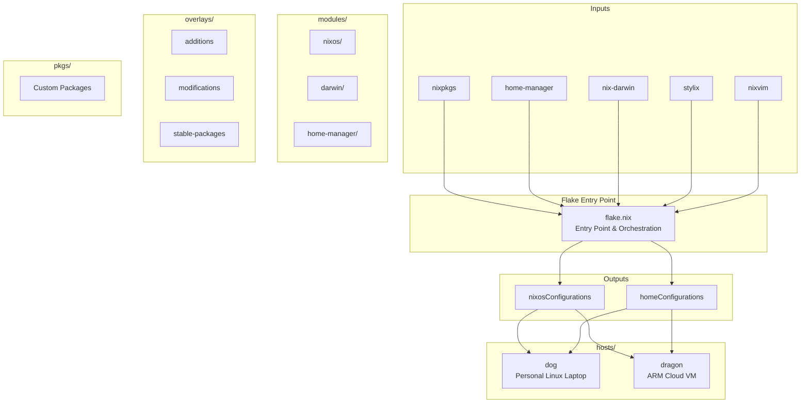

# Nix Dotfiles


A comprehensive Nix flake-based dotfiles repository managing system configurations on **NixOS**, plus Home Manager user environments (nix-darwin modules are also maintained).

## Overview

This repository provides a unified, declarative configuration system for managing:

- **2 machines** on NixOS (x86_64 Linux laptop, aarch64 cloud VM)
- **60+ reusable modules** with consistent enable patterns
- **AI tooling** (Claude Code, Codex, T3 Code, Antigravity CLI, OpenCode)
- **Development environment** (Neovim with 30+ plugins, tmux, git workflows)
- **Secret management** via SOPS with age encryption
- **System theming** via Stylix with base16 color schemes

## Quick Start

### Prerequisites

- [Nix](https://nixos.org/download.html) with flakes enabled
- Git

### Installation

```bash
# Clone the repository
git clone https://github.com/idjoo/dotfiles ~/dotfiles
cd ~/dotfiles

# Apply configuration based on your platform
nh home switch ~/dotfiles           # Home Manager only
nh os switch ~/dotfiles              # NixOS (Linux)
nh darwin switch ~/dotfiles         # macOS
```

### Common Commands

```bash
# Rebuild system configurations
nh home switch ~/dotfiles           # Home Manager only
nh os switch ~/dotfiles              # NixOS (Linux)
nh darwin switch ~/dotfiles         # macOS

# Format Nix files
nix fmt

# Update all flake inputs
nix flake update

# Update specific input
nix flake update nixpkgs

# Stage new files (required before rebuild)
git add <new-files>
```

## Architecture



### Host Matrix

| Host | Platform | Architecture | Type | Description |
|------|----------|--------------|------|-------------|
| **dog** | NixOS | x86_64-linux | Laptop | Personal Linux laptop, herbstluftwm |
| **dragon** | NixOS | aarch64-linux | Server | OCI ARM cloud VM, Komodo, Tailscale exit node |

### Module System

All modules follow a consistent enable pattern:

```nix
# In host configuration (e.g., hosts/dog/home.nix)
modules = {
  neovim.enable = true;
  zsh.enable = true;
  tmux.enable = true;
  git = {
    enable = true;
    email = "your@email.com";
  };
  utils = {
    enable = true;
    cli.enable = true;
    gui.enable = true;
  };
};
```

Modules are auto-imported via `outputs.homeManagerModules`, `outputs.nixosModules`, or `outputs.darwinModules`.

## Directory Structure

```
├── flake.nix              # Entry point: inputs, outputs, host definitions
├── flake.lock             # Locked dependency versions
├── CLAUDE.md              # Claude Code agent instructions
├── README.md              # This file
│
├── hosts/                 # Per-machine configurations
│   ├── dog/               # NixOS laptop
│   │   ├── config.nix     # System configuration
│   │   ├── home.nix       # Home Manager configuration
│   │   ├── hardware.nix
│   │   └── disko.nix
│   └── dragon/            # NixOS cloud VM (Komodo)
│
├── modules/               # Reusable configuration modules
│   ├── home-manager/      # Cross-platform user modules (40+)
│   │   ├── ai/            # AI CLIs (claude-code, codex, t3code, …)
│   │   ├── neovim/        # Nixvim configuration (30+ plugins)
│   │   ├── zsh/           # Shell configuration
│   │   ├── tmux/          # Terminal multiplexer
│   │   └── ...
│   ├── nixos/             # Linux-specific system modules
│   └── darwin/            # macOS-specific system modules
│
├── overlays/              # Package overlays
│   └── default.nix        # additions, modifications, stable-packages
│
├── pkgs/                  # Custom package definitions
│   ├── dank-mono-nerdfont/
│   └── ...
│
└── secrets/               # SOPS-encrypted secrets
    └── config.yaml
```

## Key Features

### AI & Development Tooling

- **AI CLIs**: Claude Code, Codex, T3 Code, Antigravity CLI and OpenCode installed via `modules.ai` (configs managed by hand)
- **Neovim**: Nixvim-managed editor with 30+ plugins (LSP, Treesitter, Telescope, etc.)

### Cross-Platform Abstractions

Modules automatically adapt to the platform:

```nix
# Example: tmux prefix key adapts to platform
prefix = if pkgs.stdenv.isDarwin then "ƒ" else "M-f";

# Example: Playwright browser path
executablePath = if pkgs.stdenv.isDarwin
  then ".../chrome-mac-arm64/..."
  else ".../chrome-linux/chrome";
```

### Secret Management

SOPS with age encryption for managing secrets:

```nix
# Per-host SSH key selection
sshKey = {
  dog = "idjo";
  dragon = "idjo";
}."${hostName}";
```

### Theming

Stylix-based system-wide theming with Catppuccin Frappe:

- Consistent colors across terminal, Neovim, and GUI apps
- Base16 color scheme integration
- Custom font configuration (DejaVu, RobotoMono, Noto Emoji)

## Module Categories

### Home Manager Modules (Cross-Platform)

| Category | Modules |
|----------|---------|
| **AI** | ai, playwright |
| **Editors** | neovim (nixvim) |
| **Shells** | zsh, nushell |
| **Terminals** | ghostty, wezterm, urxvt |
| **Browsers** | firefox, zen-browser, qutebrowser |
| **Git** | git, lazygit |
| **Utils** | atuin, btop, direnv, eza, fzf, zoxide |
| **Security** | gpg, password-store, sops, ssh |
| **Desktop** | herbstluftwm, polybar, dunst, rofi, cava, flameshot |
| **Theming** | stylix |

### NixOS Modules (Linux)

| Module | Description |
|--------|-------------|
| nix | Flake settings, substituters |
| nh | Nix helper rebuild tool |
| tailscale | VPN networking |
| pipewire | Audio system |
| xremap | Keyboard remapping |
| sops | System-level secrets |

### Darwin Modules (macOS)

| Module | Description |
|--------|-------------|
| aerospace | Tiling window manager |
| homebrew | Cask/formula management |
| podman | Container runtime |
| tailscale | VPN networking |

## Adding a New Host

1. Create host directory:
   ```bash
   mkdir -p hosts/newhost
   ```

2. Create system configuration (`hosts/newhost/config.nix`):
   ```nix
   { inputs, outputs, ... }:
   {
     imports = [ outputs.nixosModules ];  # or darwinModules

     modules = {
       nix.enable = true;
       nh.enable = true;
       # ... other system modules
     };
   }
   ```

3. Create home configuration (`hosts/newhost/home.nix`):
   ```nix
   { outputs, ... }:
   {
     imports = [ outputs.homeManagerModules ];

     home.username = outputs.username;

     modules = {
       neovim.enable = true;
       zsh.enable = true;
       # ... other modules
     };

     home.stateVersion = "24.05";
   }
   ```

4. Add to `flake.nix`:
   ```nix
   nixosConfigurations.newhost = nixpkgs.lib.nixosSystem {
     specialArgs = { inherit inputs outputs rootPath; };
     modules = [ ./hosts/newhost/config.nix ];
   };

   homeConfigurations."idjo@newhost" = inputs.home-manager.lib.homeManagerConfiguration {
     pkgs = pkgsFor.x86_64-linux;
     extraSpecialArgs = { inherit inputs outputs rootPath; hostName = "newhost"; };
     modules = [ ./hosts/newhost/home.nix ];
   };
   ```

5. Stage and build:
   ```bash
   git add hosts/newhost
   nh os switch  # or nh home switch ~/dotfiles
   ```

## Creating a New Module

1. Create module file (`modules/home-manager/mymodule/default.nix`):
   ```nix
   { lib, config, pkgs, ... }:
   let
     cfg = config.modules.mymodule;
   in
   {
     options.modules.mymodule = {
       enable = lib.mkEnableOption "mymodule";
       # Additional options here
     };

     config = lib.mkIf cfg.enable {
       # Configuration when enabled
       home.packages = [ pkgs.mypackage ];
     };
   }
   ```

2. Add to module index (`modules/home-manager/default.nix`):
   ```nix
   imports = [
     # ... existing imports
     ./mymodule
   ];
   ```

3. Enable in host config:
   ```nix
   modules.mymodule.enable = true;
   ```

## Overlays

Three overlay types are available:

| Overlay | Purpose | Usage |
|---------|---------|-------|
| `additions` | Custom packages from `pkgs/` | `pkgs.mypackage` |
| `modifications` | Patched upstream packages | Override existing |
| `stable-packages` | Stable channel packages | `pkgs.stable.package` |

## Documentation

- **[CLAUDE.md](./CLAUDE.md)** - Instructions for Claude Code agents
- **[docs/ARCHITECTURE.md](./docs/ARCHITECTURE.md)** - Detailed architecture documentation
- **[docs/MODULES.md](./docs/MODULES.md)** - Complete module reference
- **[docs/USER-GUIDE.md](./docs/USER-GUIDE.md)** - Common operations guide

### Man Pages

```bash
man configuration.nix         # NixOS options
man darwin-configuration.nix  # macOS options
man home-configuration.nix    # Home Manager options
man nixvim                    # Nixvim options
```

## License

MIT License - See [LICENSE](./LICENSE) for details.

---

**Username**: Defined globally as `outputs.username = "idjo"`

**Important**: New files must be `git add`ed before Nix commands can see them (flake restriction).
